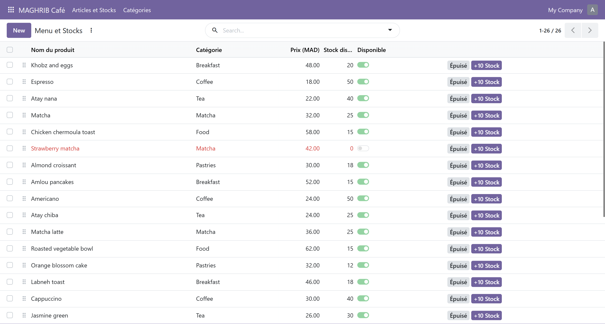

# MAGHRIB Café: Odoo 20 Module + Headless REST API

> A barista marks an item as sold out in Odoo, and the React menu shows an **Épuisé** badge on the next load.

A custom **Odoo 20.0** backend module (`maghrib_cafe_menu`) that manages menu categories, Moroccan Dirham (`MAD`) pricing and live stock availability for the **MAGHRIB Café** web application, exposed through a headless JSON API.

**Related repositories:** [Frontend (React + Vite)](https://github.com/py-amine/maghrib-cafe)

---

## Screenshots

| Odoo back-office |
|---|
|  |

---

## Key Features

- **Category & service window management (`maghrib.cafe.category`):** organizes the menu into structured sections (`01` Breakfast through `06` Pastries) with configurable display order and service hours (`DAILY 08:00-12:00`, `FROM 12:00`).
- **Menu & stock control (`maghrib.cafe.item`):** tracks 26 items priced in `MAD`, computes availability automatically (`is_available = qty_available > 0`), highlights out-of-stock rows in red in the back-office, and provides one-click stock actions (**Épuisé** / **+10 Stock**).
- **Headless REST API (`GET /api/v1/menu`):** public, read-only JSON endpoint serving active categories with nested menu items and stock flags to the React + Vite frontend. Stock data is read from the database on every request.
- **Graceful degradation:** the frontend falls back to local static data if the Odoo backend is unreachable.

---

## Tech Stack

- **ERP & Backend:** Odoo 20.0 (`20.0-20261010`), Python 3.12+
- **Database:** PostgreSQL
- **Frontend consumer:** React + Vite ([`maghrib-cafe`](https://github.com/py-amine/maghrib-cafe))
- **Modeling:** Merise (MCD/MLD) & UML (PlantUML)

---

## Installation

**Requirements:** Odoo 20.0, Python 3.12+, PostgreSQL

1. Copy the `maghrib_cafe_menu/` folder into your Odoo `addons` directory.
2. Add that directory to `addons_path` in `odoo.conf`.
3. Restart Odoo, enable developer mode, then go to **Apps → Update Apps List**.
4. Search for **MAGHRIB Café Menu** and install it. Seed data loads the 6 categories and 26 items.
5. In `odoo.conf`, set the database filter so the public API can select the database without a session:

   ```ini
   dbfilter = ^maghrib_cafe$